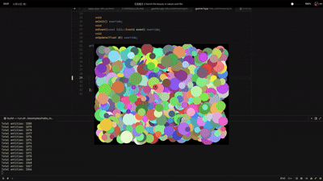

# Lili2D

   [](https://github.com/Linirby/Lili2D/actions/workflows/ci.yml)

Lili2D is a lightweight 2D game engine written in C++20, built on top of **SDL3** and **SDL_GPU**.

I created this project to learn modern engine architecture and have a fast, clean framework for 2D games and game jams. :3



## Table of Contents

- [Features](#features)
- [Prerequisites](#prerequisites)
- [Building](#building)
- [Quick Start](#quick-start)
- [Examples](#examples)
- [Documentation](#documentation)
- [Community & Support](#community--support)

## Features

- **SDL_GPU Renderer**: Hardware-accelerated 2D rendering with automatic sorting and batching (`Render2DSystem`, `DynamicBatch`, `StaticBatch`) for sprites, primitives (rectangles, circles, lines), and bitmap text.
- **Entity Component System (ECS)**: Contiguous sparse-set component pools with multi-component queries (`ECSView`), entity prefabs (`createSprite`, `createRect`, `createCircle`, `createLine`, `createText`, `createAnimatedSprite`), and a deferred command buffer.
- **Zero-Allocation Text & Materials**: Contiguous `StringArena` for text components and ID-based `MaterialRegistry` for custom shaders and uniform buffers.
- **Fixed Timestep**: Deterministic 60 TPS update loop with frame interpolation.
- **Asset Management**: Automatic caching for textures and shaders, with file hot-reloading (`Assets`).
- **UI Anchors & Pivots**: Declarative `cUILayout` and `UILayoutSystem` for screen positioning and virtual resolution scaling.
- **Multithreading**: C++20 thread pool with priority queues (`HIGH`, `NORMAL`, `LOW`) and parallel ECS system execution.
- **Collisions**: Fast 2D AABB and circle collision checks.

## Prerequisites

- **C++20 compiler** (GCC 10+, Clang 11+, or MSVC 2019+)
- **CMake** 3.10+
- **SDL3**, **SDL3_image**, and **SDL3_shadercross**

## Building

```bash
git clone https://github.com/Linirby/Lili2D.git
cd Lili2D
cmake -B build
cmake --build build -j$(nproc)
```

Run tests:

```bash
ctest --test-dir build --output-on-failure
```

## Quick Start

Here is a minimal example setting up a window, spawning a sprite with UI anchoring, and creating shapes via the ECS:

```cpp
#include <lili2d/lili2d.hpp>

class App : public lili::Game {
public:
    App() : lili::Game("Hello Lili2D :3", 800, 800) {}

    void onInit() override {
        // Set virtual logical resolution (automatic aspect ratio scaling)
        getWindow()->setLogicalResolution(800, 800);

        // Load a texture
        lili::Texture* cat_tex = lili::Assets::loadTexture(
            "cat", "assets/textures/cat.png", getRenderer()->getDevice()
        );

        auto& registry = getECSRegistry();

        // Create a sprite entity with UI anchor & pivot positioning
        lili::Entity sprite = lili::createSprite(registry, cat_tex);
        registry.addComponent<lili::cUILayout>(
            sprite,
            lili::cUILayout{
                .anchor = lili::Anchor::CENTER,
                .pivot = lili::Pivot::CENTER,
                .offset = { 0.0f, -50.0f }
            }
        );

        // Create a filled circle entity
        lili::createCircle(
            registry,
            { .position = { 400.0f, 600.0f },
              .radius = 60.0f,
              .color = { 0.2f, 0.6f, 1.0f, 1.0f },
              .segments = 32 }
        );

        // Create a hollow rectangle entity
        lili::createRect(
            registry,
            { .position = { 50.0f, 50.0f },
              .size = { 120.0f, 40.0f },
              .color = { 1.0f, 0.5f, 0.0f, 1.0f },
              .hollow = true }
        );
    }

    void onUpdate(float dt) override {
        (void)dt;
    }

    void onRender(float alpha) override {
        (void)alpha;
    }
};

int main() {
    App app;
    app.run();
    return 0;
}
```

## Examples

Check out the [`examples/`](examples/) directory for standalone demo projects covering shapes, sprites, animations, custom shaders, and ECS.

## Documentation

Full API documentation is available at: [https://linirby.github.io/Lili2D](https://linirby.github.io/Lili2D)

Or generate it locally with Doxygen:

```bash
cd docs
doxygen Doxyfile
```

## Community & Support

- Discord: **[Lili's | Dev Lounge](https://discord.gg/6S6HyKWgK3)**
- Support: **[ko-fi.com/liliowo](https://ko-fi.com/liliowo)** ❤️
