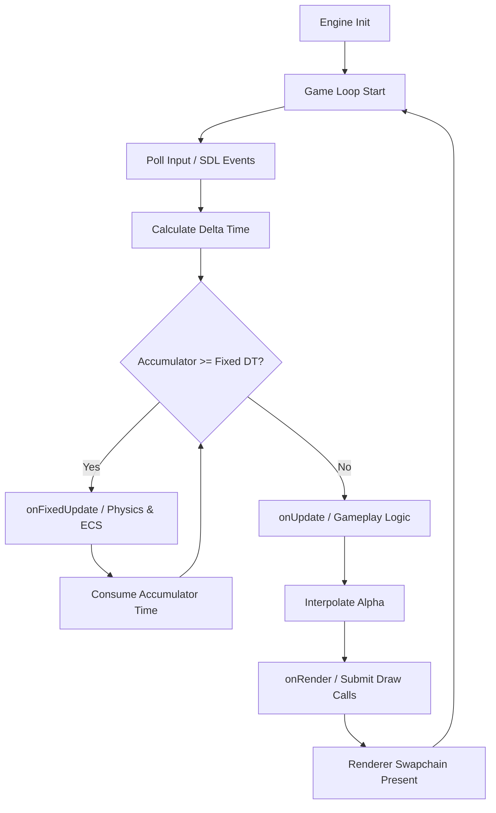
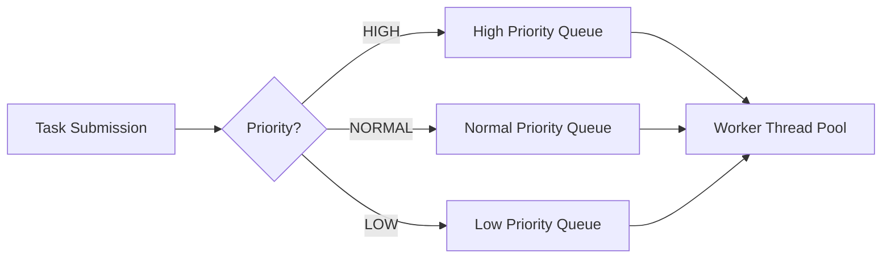
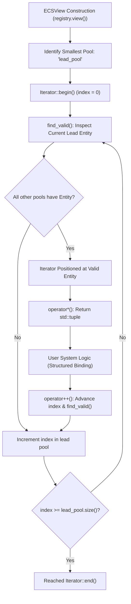
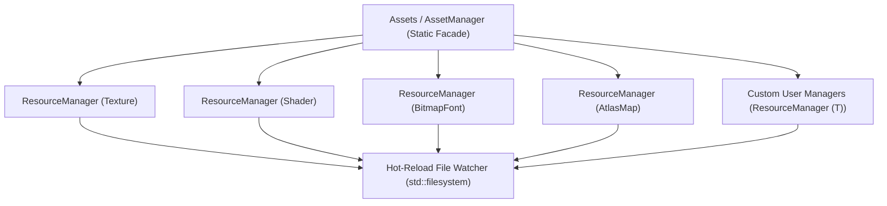
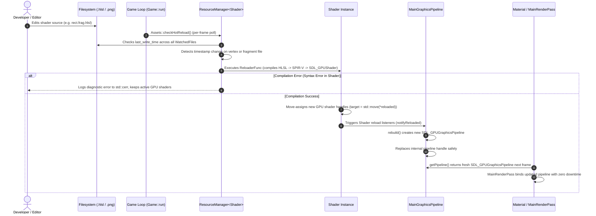
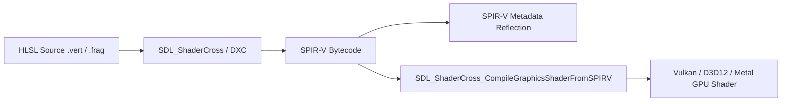

# Lili2D Engine Architecture

An overview of the core subsystems, memory layouts, and rendering pipeline in Lili2D.

---

## Table of Contents

1. [Engine Core & The Game Loop](#1-engine-core--the-game-loop)
2. [Multithreading (`ThreadPool`)](#2-multithreading-threadpool)
3. [Entity Component System (ECS)](#3-entity-component-system-ecs)
4. [Asset & Resource Engine](#4-asset--resource-engine)
5. [Live Asset & Shader Hot-Reloading](#5-live-asset--shader-hot-reloading)
6. [UI Layout Engine & Matrix Transform](#6-ui-layout-engine--matrix-transform)
7. [Viewport Scaling & Logical Resolution](#7-viewport-scaling--logical-resolution)
8. [Physics & Collision](#8-physics--collision)
9. [Rendering & GPU Memory](#9-rendering--gpu-memory)
10. [Custom Shader & Uniform Buffer](#10-custom-shader--uniform-buffer)
11. [Input Action Mapping](#11-input-action-mapping)
12. [Animation & Sprite Slicing](#12-animation--sprite-slicing)
13. [Modern C++ & Guidelines](#13-modern-c--guidelines)

---

## 1. Engine Core & The Game Loop

Lili2D centers around a fixed-timestep game loop that decouples deterministic physics updates (TPS) from variable rendering framerates (FPS) using an accumulator pattern.



### Core Architecture Highlights

* **RAII & Encapsulated Subsystems**: Low-level subsystem lifecycles (`Window`, `Renderer`, `ThreadPool`, `SceneManager`) are owned by `Game` and accessed through getter methods.
* **Runtime Config (`GameConfig`)**: Manages window modes (fullscreen, borderless, resizable, relative mouse) and keeps them synchronized with the active `Game` instance.

---

## 2. Multithreading (`ThreadPool`)

To maximize multi-core CPU utilization while eliminating frame-pacing stutter, Lili2D provides a custom C++20 task scheduler (`lili::ThreadPool`) featuring explicit **task prioritization** (High, Normal, Low).



```cpp
// Worker threads drain queues in strict priority order: HIGH -> NORMAL -> LOW
auto& q = !high_tasks.empty()   ? high_tasks
        : !normal_tasks.empty() ? normal_tasks
                                : low_tasks;
task = std::move(q.front());
q.pop();
```

---

## 3. Entity Component System (ECS)

Lili2D implements an Entity Component System (`lili::ECSRegistry`) designed around contiguous memory layouts and data-oriented design (DOD).

### Contiguous Memory Allocation (`ComponentPool<T>`)

Components of type `T` are stored sequentially in packed vectors (`std::vector<T>`), keeping data contiguous in memory for cache efficiency during updates.

```txt
[ComponentPool<Pos>] -> [ Pos0 ][ Pos1 ][ Pos2 ][ Pos3 ] <- (Contiguous Block)
[ComponentPool<Vel>] -> [ Vel0 ][ Vel1 ][ Vel2 ][ Vel3 ] <- (Contiguous Block)
```

### Multi-Component Query (`ECSView`)

Lili2D queries entities possessing combinations of components via `lili::ECSView<Components...>`, backed by a custom C++20 forward iterator (`ECSView::Iterator`) with zero heap allocation.



### Iteration & Component Access

* **Zero-Copy Access (`operator*`)**: Returns `std::tuple<Entity, Components&...>`. The lead component is fetched via direct O(1) index `lead_pool->getComponents()[index]`, while secondary pools use sparse lookups.

```cpp
// In-place mutation over contiguous component memory with structured bindings
for (auto&& [entity, pos, vel, render] : registry.view<Position, Velocity, Render>()) {
    pos.value += vel.value * dt; // Direct in-place pool modification, zero heap alloc
}
```

### Thread-Safe Command Buffer

Modifying ECS state (spawning/destroying entities, attaching components) during multithreaded execution creates data races. Lili2D provides `lili::CommandBuffer`:
1. Worker threads query components concurrently and enqueue mutations to thread-safe queues.
2. At frame tick completion, the main thread flushes `CommandBuffer` into `ECSRegistry`, guaranteeing lock-free system updates.

---

## 4. Asset & Resource Engine

Asset management in Lili2D is powered by templated resource managers (`lili::ResourceManager<T>`) and a static facade (`lili::AssetManager` / `lili::Assets`).



### Key Design Patterns

* **Polymorphic Base Interface (`IResourceManager`)**: Enables uniform lifecycle management, scope unloading, and hot-reload polling across different asset types.
* **Scoped Memory Isolation (`unloadScope`)**: Resources are assigned scope tags (e.g. `"global"`, `"main_menu"`, `"level_01"`). Calling `Assets::unloadScope("level_01")` prevents memory leaks during scene transitions.
* **Extensible Type Registry**: Custom user asset types `T` can be registered dynamically via `Assets::getManager<T>()`, granting them full caching, scope control, and hot-reloading capabilities.

---

## 5. Live Asset & Shader Hot-Reloading

Lili2D implements a multi-stage hot-reloading pipeline that allows developers to modify textures, fonts, sprite sheets, and custom HLSL shaders (`.vert.hlsl` / `.frag.hlsl`) on disk while the game is running, updating GPU state in real-time without application restarts.



---

## 6. UI Layout Engine & Matrix Transform

All rendered 2D entities in Lili2D use `TransformComponent` (`pos`, `scale`, `rotation`), `Render2DComponent` (`size`, `color`, `layer`, `material_id`, `render_pass`, `visible`), and an optional `UILayoutComponent` processed by `lili::UILayoutSystem`.

### UI Pivot & Anchor Normalization (`UILayoutSystem`)

`UILayoutSystem` computes screen-space positions for entities possessing `UILayoutComponent`, `Render2DComponent`, and `TransformComponent` using normalized **Anchors** (relative to the logical viewport) and **Pivots** (relative to the element's bounding box or measured `TextComponent` bounds):

```cpp
Vec2 screen_pos = (viewport_size * anchor) + offset - (element_size * pivot);
```

### 3x3 Affine Matrix Transformation (`Mat3`)

Projections and camera views combine translation, rotation, and scale into a 3x3 transformation matrix (`Mat3`):

```cpp
Mat3 transform = Mat3::translate(pos) *
                 Mat3::rotation(rotation_rad) *
                 Mat3::scale(scale);
```

---

## 7. Viewport Scaling & Logical Resolution

To protect game logic and UI layouts from physical display resolution changes, window resizing, and aspect ratio variations, Lili2D provides a **Logical Resolution** subsystem (`Window::setLogicalResolution`).

### Aspect-Ratio Letterboxing

The engine computes scale factors and centers the game viewport within physical window dimensions using pillarboxing or letterboxing:

```cpp
float scale = std::min(physical_width / logical_width, physical_height / logical_height);
```

### Coordinate Space Mapping (`toLogicalCoords`)

Input events recorded in physical screen pixels are converted into logical game coordinates automatically:

```cpp
Vec2 logical_pos = (physical_pos - viewport_offset) / scale;
```

---

## 8. Physics & Collision

Lili2D provides lightweight spatial primitive colliders for 2D gameplay physics, raycasting, and broad-phase/narrow-phase queries.

### Collision Primitives & Math

* **`AABB2` / `AABB3`**: Axis-Aligned Bounding Boxes with `min` and `max` vectors for broad-phase bounding hierarchies and hitboxes.
* **`CircleCollider`**: Precise circle-to-circle, circle-to-box, and circle-to-line segment collision solver.

```cpp
// Circle-to-AABB clamp narrow-phase intersection
Vec2 closest = { std::clamp(circle.center.x, aabb.min.x, aabb.max.x),
                 std::clamp(circle.center.y, aabb.min.y, aabb.max.y) };
bool hit = (circle.center - closest).lengthSquared() <= (circle.radius * circle.radius);
```

### Debug & Primitive Visualization via ECS

Colliders expose a `.getShape()` method returning geometric primitives (`RectShape`, `CircleShape`), which can be visualized or synchronized with ECS primitive entities (`RectComponent`, `CircleComponent`, `LineComponent`) created via `createRect`, `createCircle`, and `createLine`.

---

## 9. Rendering & GPU Memory

Lili2D relies on SDL3's `SDL_GPU` for direct modern graphics execution (Vulkan, Direct3D 12, Metal).

### Unified 2D Sorting & Batching (`Render2DSystem`, `DynamicBatch`, `StaticBatch`)

To minimize GPU state changes and draw calls, `Render2DSystem` collects all visible 2D ECS entities (`SpriteComponent`, `RectComponent`, `CircleComponent`, `LineComponent`, `TextComponent`) into a flat, trivially copyable `DrawItem` array and sorts indices by:
1. `render_pass` (`PIXEL_WORLD2D`, `WORLD2D`, `UI`)
2. `layer` (Z-depth)
3. `material_id` (`MaterialRegistry`)
4. `entity` & `texture`

Sorted items are appended via `BatchHelper` into a `DynamicBatch`, merging sprites, primitives, and bitmap text sharing the same render state into a single GPU vertex/index buffer upload and draw call. For static geometry (such as level backgrounds or chunk meshes), `StaticBatch` bakes vertices once into persistent VRAM (`GPUMesh`).

### Zero-Allocation Text Storage (`StringArena`)

To keep `TextComponent` trivially copyable and cache-friendly inside ECS pools without heap-allocating `std::string` per entity, `ECSRegistry` owns a contiguous `StringArena` (`std::vector<char>`) with free-list block reuse (`FreeSpace`). `TextComponent` stores only a `uint32_t offset` and `uint32_t length` into the arena.

### GPU Idle Synchronization & Deleter Protections

To eliminate hardware race conditions and Vulkan descriptor validation errors during resource reloads or scene teardowns:
* **RAII GPU Deleters**: Device-dependent deleters (`SDLGPUTextureDeleter`, `SDLGPUBufferDeleter`, etc.) call `SDL_WaitForGPUIdle(device)` before releasing GPU memory.
* **Defensive Render Pass Validation**: `MainRenderPass::render()` verifies vertex/index buffers and textures are non-null before binding, skipping incomplete assets gracefully during hot-reloads.

---

## 10. Custom Shader & Uniform Buffer

Lili2D unifies shaders around **HLSL** as the primary shading language, cross-compiling shaders dynamically to the active backend driver via `SDL_ShaderCross`.



### Direct Uniform Push & `MaterialRegistry`

Lili2D utilizes SDL3 GPU's uniform push model rather than allocating persistent descriptor uniform buffers per draw call, managed centrally via `lili::MaterialRegistry`:
* **Vertex Slot 0 (Engine Uniforms)**: MVP matrix (3x4 columns), tint color (`Vec4`), UV bounds (`Vec4`), render layer, and elapsed engine time.
* **Vertex Slot 1 & Fragment Slot 0 (Custom User Uniforms)**: Arbitrary user-defined structs pushed into the command buffer stream via `Material::setVertexUniforms(data)` and `Material::setFragmentUniforms(data)`. Entities reference materials by lightweight `uint16_t material_id` handles stored on `Render2DComponent`.

```cpp
struct WaveUniforms { float time, amplitude, frequency, speed; };
uint16_t mat_id = MaterialRegistry::get().createMaterial("wave", pipeline);
MaterialRegistry::get().getMaterial(mat_id)->setFragmentUniforms(
    WaveUniforms{ clock.getTime(), 0.2f, 30.0f, 5.0f }
);
```

---

## 11. Input Action Mapping

The centralized `lili::ActionMap` separates game logic from physical hardware input devices using string-keyed logical actions:

```cpp
ActionMap::get().add("Jump", { Key::SPACE, Key::W });
ActionMap::get().add("Shoot", {}, { MouseButton::LEFT });
```

### Input State Queries

The action map processes input transitions per frame, allowing systems to query:
* `isHeld("MoveRight")`: Returns `true` continuously while any assigned physical key/button is depressed.
* `isJustPressed("Jump")`: Returns `true` strictly on the exact frame the action was activated.
* `isJustReleased("Shoot")`: Returns `true` strictly on the frame the action was released.

---

## 12. Animation & Sprite Slicing

Lili2D handles 2D sprite animations through `AtlasMap`, `AnimationRegistry`, `AnimationComponent`, and `AnimationSystem`.

### Sub-Texture UV Slicing (`AtlasMap`)

Spritesheets are sliced into uniform grid cells (`slice(cols, rows)`). The engine computes normalized UV bounding coordinates for each frame:

```cpp
// Normalized UV bounds for a tile cell (col, row):
Vec2 uv_min = { static_cast<float>(col) / cols, static_cast<float>(row) / rows };
Vec2 uv_max = { static_cast<float>(col + 1) / cols, static_cast<float>(row + 1) / rows };
```

### ECS Animation Playback (`AnimationComponent` & `AnimationSystem`)

* **Registry-Backed Clips**: `Animation` clips store a sequence of `SliceUV` frames and a `frame_duration`, registered in `AnimationRegistry` with a `uint16_t` ID.
* **Data-Oriented Playback**: `AnimationSystem` iterates over entities with `AnimationComponent` and `SpriteComponent`, advancing `timer` by `dt * speed`, updating `current_frame` (supporting looping and one-shot playback), and writing the active frame's `u_min`, `v_min`, `u_max`, `v_max` directly into `SpriteComponent`.

---

## 13. Modern C++ & Guidelines

Lili2D adheres to modern C++20 practices across all engine subsystems, focusing on zero static initialization overhead and cache-friendly data structures.

### Guidelines Overview

* **Pass-by-Value (<= 16B PODs)**: Small types (`Vec2`, `Vec3`, `Vec4`, `Point2/3`, `RectShape`, `CircleShape`, `Entity`) are passed by value to avoid pointer indirection and keep values in CPU registers.
* **Targeted Header Inlining**: Hot per-frame math functions, geometry utilities, and fast property accessors are inlined in headers. Heavy subsystems remain separated in `.cpp` files to keep compile times fast.
* **`constexpr` Constructors**: Primitives (`VecN`, `PointN`, `RectShape`, `CircleShape`, `CircleCollider`) and `Clock` use `constexpr` constructors for compile-time validation and static constant baking.
* **`[[nodiscard]]` Safety Enforcement**: Input queries (`Keyboard::justPressed`), time stepping (`Clock::step()`), and math transforms use `[[nodiscard]]` to prevent ignored results.
* **`noexcept` Move Semantics**: Resource holders (`GPUMesh`, `Shader`, `Texture`, `Window`, `Pipeline`) provide `noexcept` move operations, enabling efficient vector reallocations.

### Concrete Code Contracts

```cpp
// 1. Compile-time validation of geometry & collision invariants
constexpr CircleCollider collider{Vec2{0.0f, 0.0f}, 15.0f};
static_assert(collider.contains(Vec2{5.0f, 5.0f}), "Collision math must be valid at compile-time!");

// 2. Guaranteed noexcept move semantics on RAII GPU wrappers
GPUMesh(GPUMesh&& other) noexcept = default;
GPUMesh& operator=(GPUMesh&& other) noexcept = default;

// 3. Structured bindings and value passing in hot loops
for (auto [entity, pos, vel] : registry.view<Position, Velocity>()) {
    pos.value += vel.value * dt; // Operates in-place on packed memory
}
```
